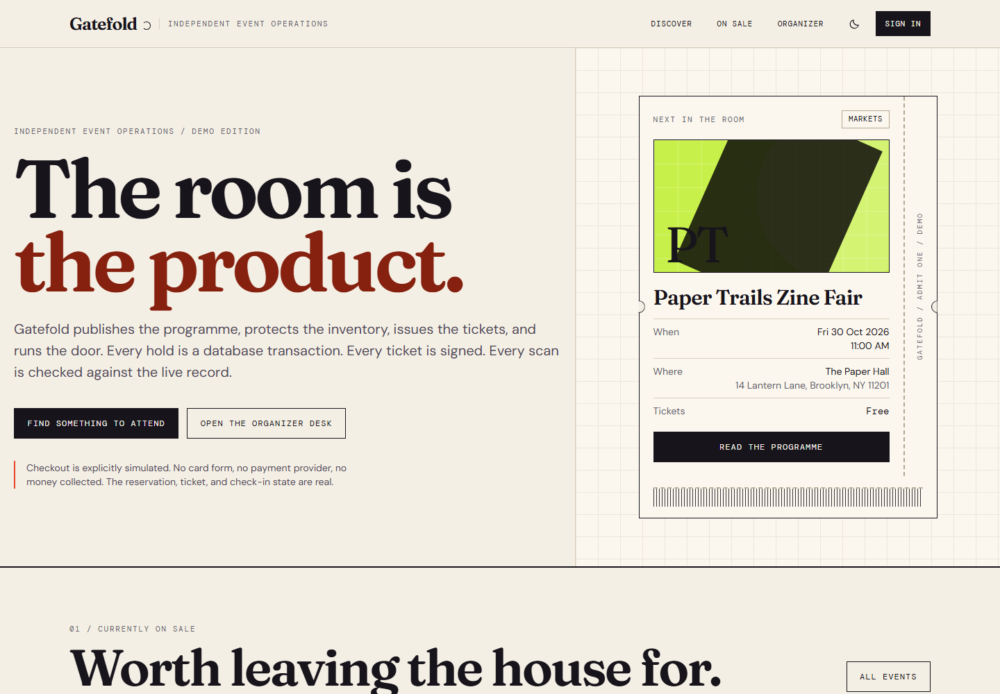
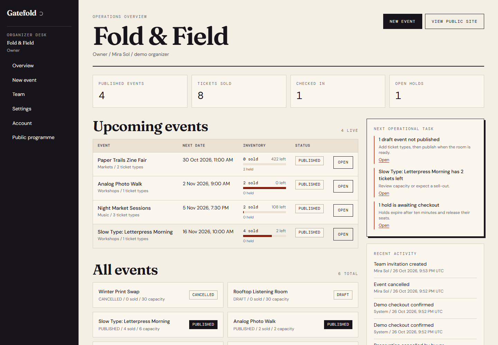
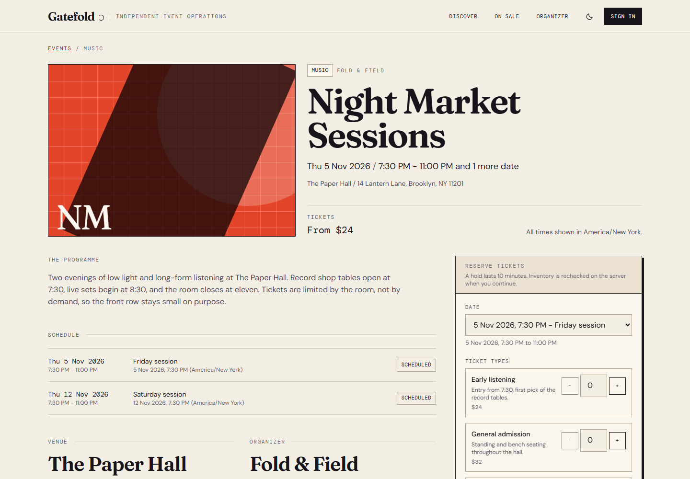
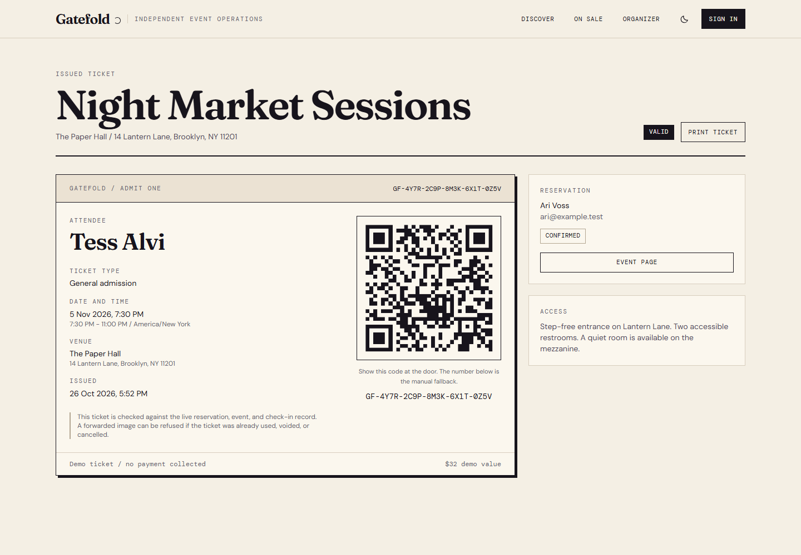
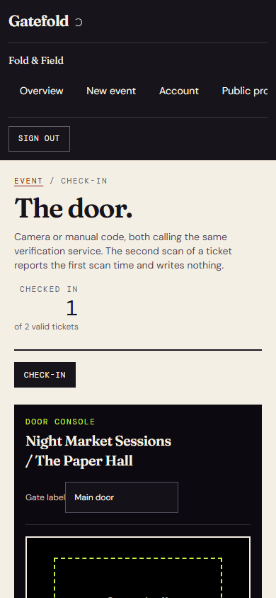
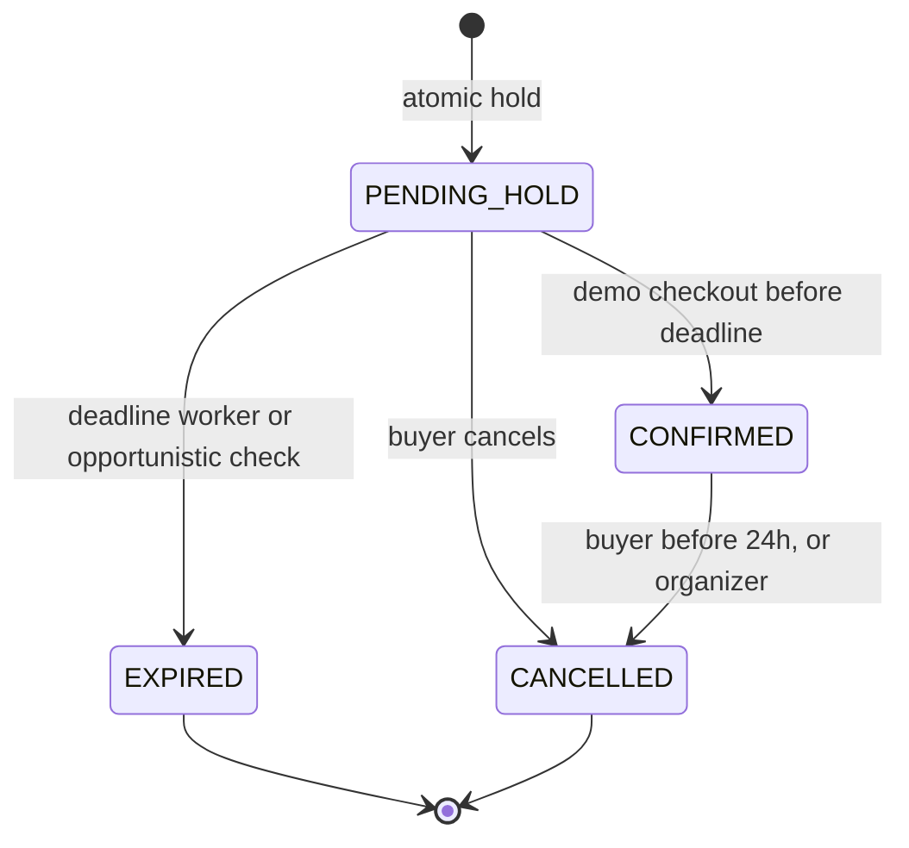

# Gatefold

[](https://gatefold-app-seven.vercel.app)
[](https://github.com/devtechedge/gatefold/actions/workflows/ci.yml)
[](LICENSE)

Event publishing, ticket inventory, issued tickets, and a check-in desk for independent organizers, venues, and small festivals.

Gatefold is a working reference implementation, not a mockup. Every hold is a PostgreSQL transaction. Every ticket carries a signed, server-verifiable reference. Every scan is checked against live ticket, reservation, occurrence, and event state. Checkout is explicitly simulated: no payment provider is connected and no money is collected.

## Live demo

https://gatefold-app-seven.vercel.app

> Demo deployment on Vercel with a seeded Neon PostgreSQL database. Checkout is simulated, no payment provider is connected, and no money is collected. The reservation, inventory, ticket, and check-in state are real.

| Discovery | Event operations |
| --- | --- |
|  |  |
|  |  |



## What it does

- Publishes events with timezone-aware occurrences, venues, categories, and editorial artwork.
- Configures ticket types, prices, sales windows, visibility, and per-occurrence capacity.
- Holds inventory for ten minutes using an atomic conditional update, so stale browser state cannot oversell a room.
- Confirms a hold through a clearly labelled demo checkout and issues one signed ticket per confirmed ticket quantity.
- Rejects duplicate scan records: the second scan of a ticket reports the first check-in time and writes nothing.
- Releases held inventory on expiry and sold inventory on cancellation without deleting reservation or ticket history.
- Provides a role-scoped organizer console for events, tickets, attendees, team management, and a mobile check-in desk.
- Assigns check-in staff per event. Owners and managers can cover every event; a CHECKIN account only reaches the events it is assigned to.

## Core invariants

1. `0 <= held + sold <= capacity` for every occurrence and ticket type.
2. A hold is created only by an atomic conditional update that checks remaining capacity in SQL. The affected row count is part of the decision.
3. Prices are snapshotted onto reservation lines at hold time. Later price changes never rewrite an existing reservation.
4. Confirmation, inventory movement, demo confirmation, and ticket issuance happen in one transaction.
5. Confirming the same reservation again returns the original tickets and issues no duplicates.
6. A ticket admits one person once. `check_in.ticketId` is unique.

## Architecture

| Layer | Responsibility |
| --- | --- |
| `app/` | Public pages, organizer pages, route handlers, loading and error states |
| `components/` | Accessible visual primitives, booking and checkout clients, check-in console |
| `domain/` | Reservation state machine, inventory rules, sales windows, permissions, ticket signing |
| `services/` | Transactional holds, checkout, cancellation, expiry, check-in, event and team operations |
| `repositories/` | Narrow database access, including the conditional inventory statements |
| `validation/` | Zod request contracts shared by pages, server actions, and APIs |
| `lib/auth/` | Opaque sessions, organizer scoping, capability checks, rate limits |
| `prisma/` | Schema, SQL migration, constraints, demo seed |

See [docs/ARCHITECTURE.md](docs/ARCHITECTURE.md), [docs/ADR.md](docs/ADR.md), and [docs/API.md](docs/API.md).

## Quick start

Prerequisites: Node 22 or newer, a PostgreSQL 16 database (Neon works), and npm.

```bash
npm install
cp .env.example .env
# Fill DATABASE_URL, DATABASE_URL_UNPOOLED, SESSION_PEPPER, TICKET_SIGNING_SECRET.
npx prisma migrate deploy
ALLOW_PROD_SEED=1 npm run db:seed
npm run dev
```

Open `http://localhost:3000`.

Useful commands:

```bash
npm run lint          # ESLint
npm run typecheck     # next typegen && tsc --noEmit
npm test              # unit + integration against DATABASE_URL_TEST
npm run e2e           # build, prepare the e2e database, run Playwright
npm run build         # production build
npm run db:migrate    # prisma migrate deploy
npm run db:seed       # demo seed, guarded by ALLOW_PROD_SEED
```

The seed refuses unrecognised database names and refuses the production database unless `ALLOW_PROD_SEED=1`. It is repeatable: it removes reservation history before events, then the organizer, then users, and recreates the demo.

## Demo accounts

These accounts exist only in the seeded demo. Do not reuse their passwords anywhere.

| Role | Email | Password |
| --- | --- | --- |
| Owner | `demo@gatefold.test` | `demo-password-1` |
| Event manager | `manager@gatefold.test` | `demo-password-1` |
| Check-in staff | `staff@gatefold.test` | `demo-password-1` |

The seed also creates a checked-in demo ticket at `/ticket/GF-7K2M-9Q4X-3B8N-6T1V-5W0Z`, a valid unchecked ticket at `/ticket/GF-4Y7R-2C9P-8M3K-6X1T-0Z5V`, a pending hold, a cancelled reservation, a cancelled event, and an invitation for `newstaff@example.test`.

## Tests

- 46 Vitest tests: 27 domain and schema tests, 19 PostgreSQL integration tests.
- 10 Playwright journeys: public catalogue and responsive widths, full booking and check-in, organizer publishing, role restrictions, security headers and health, maintenance authorization, accessibility audits, and print emulation.
- The integration suite includes a 20-way race for the final ticket, over-capacity concurrency, idempotent reservation and checkout, repeated expiry workers, cancellation, event cancellation, duplicate scans, wrong-event scans, bad signatures, void tickets, cross-organizer denial, per-event staff assignment, account anonymization, invitation acceptance, and password change.

Run counts are reported in release notes rather than hardcoded here.

## API

All API responses use `{ data }` on success and `{ error: { code, message, requestId } }` on failure. Mutating browser requests are origin-checked, and sensitive endpoints are rate-limited in PostgreSQL.

| Method | Path | Purpose |
| --- | --- | --- |
| GET | `/api/events` | Published catalogue with filters and cursor pagination |
| GET | `/api/events/[slug]` | Public event detail and display availability |
| POST | `/api/events/[slug]/reservations` | Create a ten-minute hold, optional `Idempotency-Key` |
| GET | `/api/reservations/[ref]` | Reservation status via a signed reference |
| POST | `/api/reservations/[ref]/demo-checkout` | Simulated confirmation and ticket issuance |
| POST | `/api/reservations/[ref]/cancel` | Buyer cancellation under the documented policy |
| POST | `/api/tickets/verify` | Staff ticket verification and check-in |
| GET, POST | `/api/organizer/events` | Organizer event list and creation |
| GET, PATCH | `/api/organizer/events/[id]` | Event detail, publish, unpublish, cancel, update |
| GET, POST | `/api/organizer/events/[id]/tickets` | Ticket types, capacity, visibility, status |
| GET | `/api/organizer/events/[id]/schedule` | Occurrences |
| GET | `/api/organizer/events/[id]/attendees` | Bounded attendee search |
| GET | `/api/organizer/events/[id]/check-in` | Check-in statistics and recent scans |
| GET, POST | `/api/organizer/events/[id]/staff` | Per-event check-in assignments |
| GET, POST | `/api/organizer/team` | Members, invitations, role management |
| POST | `/api/internal/expire-holds` | Bearer-protected maintenance expiry |
| GET | `/api/health` | Application and database health |

Error codes: `VALIDATION_ERROR`, `UNAUTHORIZED`, `FORBIDDEN`, `NOT_FOUND`, `CONFLICT`, `SOLD_OUT`, `HOLD_EXPIRED`, `INVALID_STATE`, `RATE_LIMITED`, `IDEMPOTENCY_CONFLICT`, `POLICY_DENIED`, `INVALID_SIGNATURE`, `WRONG_EVENT`, `INTERNAL_ERROR`.

## Reservation state machine



Expired or cancelled holds can never become confirmed. A stale checkout returns `HOLD_EXPIRED` or `INVALID_STATE`.

## Inventory concurrency

Holds use a conditional update in the same transaction as the reservation insert:

```sql
UPDATE ticket_inventory
SET held = held + $1, version = version + 1
WHERE id = $2
  AND capacity - sold - held >= $1
RETURNING id, capacity, held, sold;
```

Zero affected rows means sold out. Inventory rows are updated in a stable order to reduce deadlocks. Confirmation moves `held` to `sold` under a reservation row lock. The database also enforces `held + sold <= capacity` with a CHECK constraint.

## Ticket verification

A ticket page shows a QR payload of `GF1.<publicId>.<hmac>`. The signature is HMAC-SHA256 over the public ticket id using `TICKET_SIGNING_SECRET`. Verification recomputes the signature, then resolves the ticket against authoritative state: ticket status, reservation state, occurrence status, event status, and the expected event for the scanning desk. Manual codes go through the same verification service. The second successful scan produces `ALREADY_USED` with the first scan time.

## Demo checkout

Checkout is a recorded simulated confirmation, not a payment. A `DemoConfirmation` row stores the amount, currency, method `demo`, and a reference. The UI states this on the event page, checkout, reservation, ticket, and footer. No card form, payment provider, refund, or tax engine is connected.

## Security

Sessions are opaque random tokens stored as SHA-256 hashes with a server pepper. Passwords use scrypt, signed-in users can change their password, and changing it revokes other sessions. Reservation access references are HMAC-derived and revocable by rotating `accessVersion`. Organizer access is checked server-side for every scoped operation, and check-in staff are assigned per event. A baseline Content Security Policy is enabled in production. The threat model, controls, and residual risks are in [SECURITY.md](SECURITY.md).

## Deployment

The demo deployment runs on Vercel at https://gatefold-app-seven.vercel.app with a Neon PostgreSQL database. Set the values from `.env.example` in the hosting environment. Run `prisma migrate deploy` before serving new code. Seed only a designated demo environment. The health endpoint is `/api/health`.

## Known limitations

- Demo checkout only. No payment provider, refunds, tax, assigned seating, resale, or mobile app.
- No email delivery. Signed-in password change is available; signed-out password reset is not offered. Invitation links are shown once after creation.
- Reservation and ticket links are bearer capabilities. Anyone with the link can view that record.
- The demo uses a shared Neon host. Move to a dedicated project before real-event or paid use.
- No independent security or accessibility audit has been performed. Accessibility targets WCAG 2.2 AA and is checked with axe-core in the browser suite. The CSP allows inline scripts and styles for Next runtime; a nonce-based policy is still pending.
- Event completion is a reserved status. Published events remain published after their last occurrence.

## License

MIT. See [LICENSE](LICENSE).
